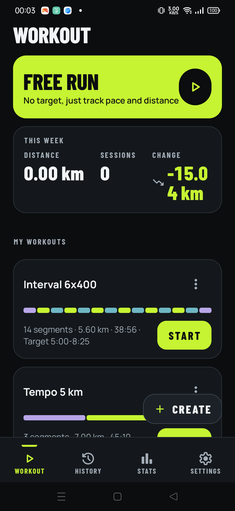
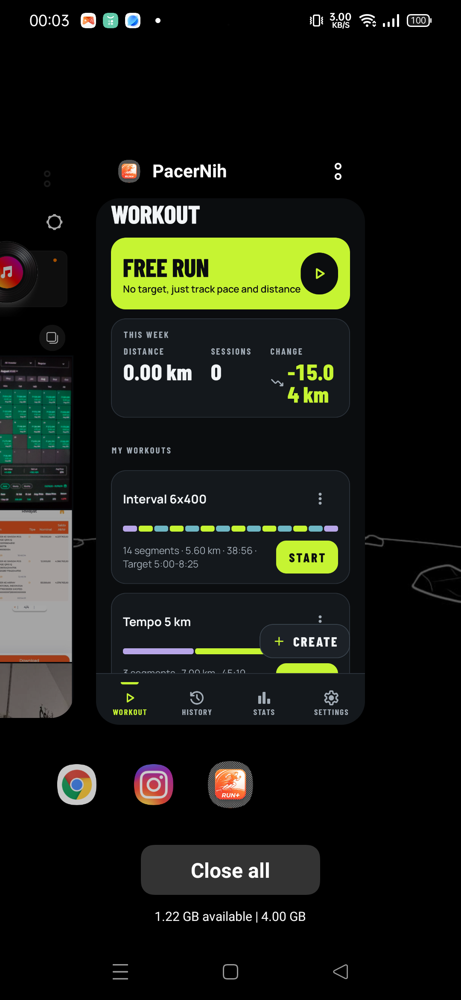
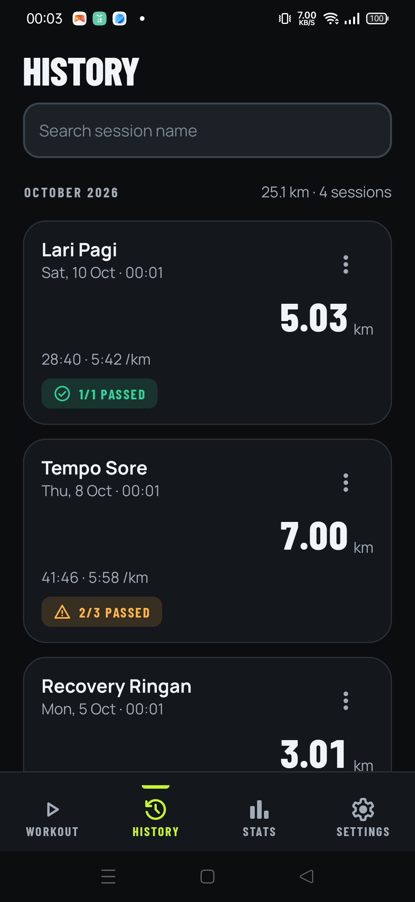
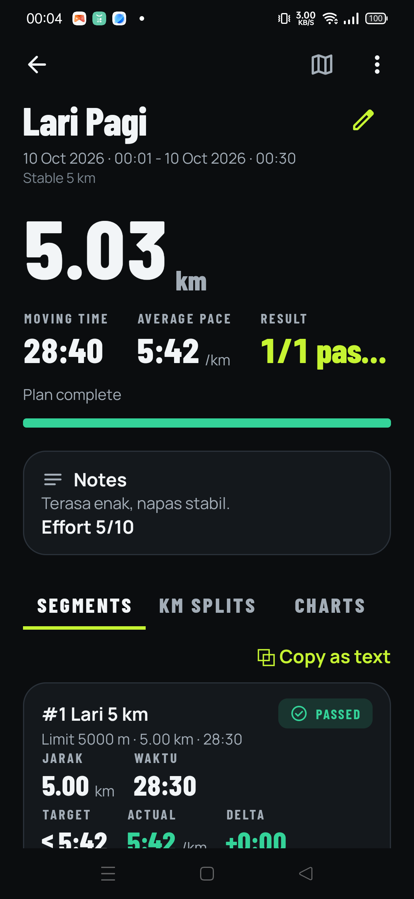
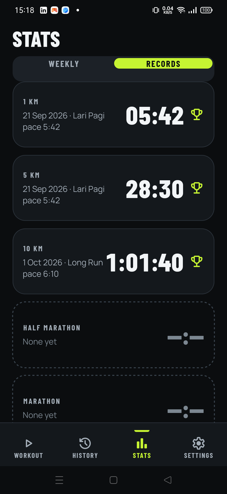
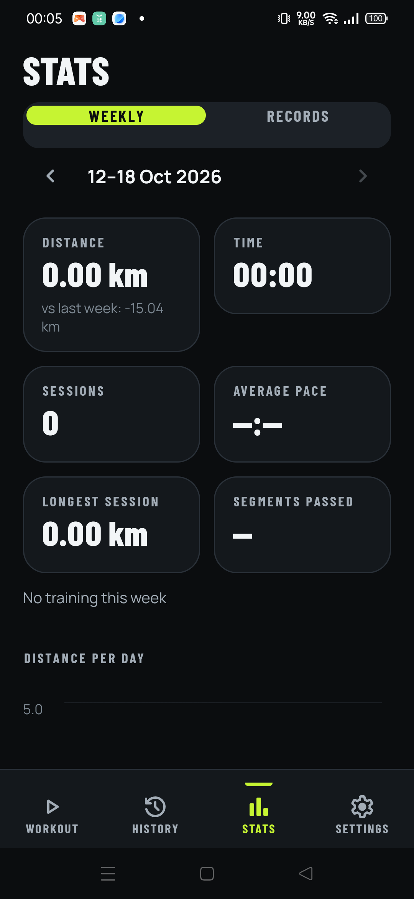
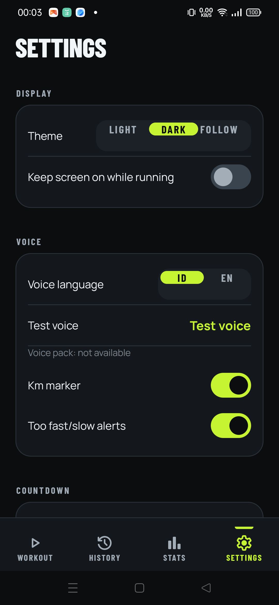

# PacerNih 🏃‍♂️

**An offline, no-cost Android running app with structured, segment-based workouts and real-time pace coaching.**

PacerNih (package `com.daniel.runcoach`) tracks distance, pace and time from GPS, runs structured
workouts (warm-up / intervals / tempo / recovery / cool-down), coaches you with voice + beeps, grades
every segment (PASS / BORDERLINE / FAIL), and keeps history, personal records and weekly stats — all
**100% on-device**. No accounts, no cloud, no API keys, no ads, no paid services.

---

## Table of contents
- [What it is](#what-it-is)
- [Features](#features)
- [Screenshots](#screenshots)
- [How it works](#how-it-works)
- [Getting started (build & run locally)](#getting-started-build--run-locally)
- [Project structure](#project-structure)
- [Tech stack](#tech-stack)
- [Permissions](#permissions)
- [Data & privacy](#data--privacy)
- [Testing](#testing)
- [Docs](#docs)
- [Credits](#credits)

---

## What it is

PacerNih is a personal Android app for running and walking with
**structured workouts**. You build a workout as an ordered list of segments, each with a **limit**
(distance or duration) and an optional **target pace**, then press Start. The app counts you down, drives
the workout automatically, tracks GPS, computes pace, speaks corrections ("too slow", "too fast", "steady"),
vibrates, and afterwards grades every segment and stores the full log.

It is designed to be **free forever** and to work **without any network connection** (map tiles are the only
optional online part, and the route still draws without them).

## Features

**Workouts**
- Segment-based workouts: type (warm-up, run, walk, recovery, cool-down), limit (distance / duration / open),
  optional target pace, and a "too fast" margin.
- **Two-way target pace**: `≤ max` (must not be slower — for runs/intervals) and `≥ min` (must not be faster —
  for warm-up / cool-down / recovery).
- **Repeat** blocks (repeat *n* times, or *until total distance*), reorderable in the editor.
- **Presets**: Stable run, Progressive tempo, Interval, Run/walk.
- Built-in **Free Run** template (no target, just measure).
- Workout editor with live validation and estimated total distance/time.

**Live run screen**
- Huge live pace, target pace, and a status band (STABIL / TERLALU LAMBAT / TERLALU CEPAT with the delta).
- Segment progress, remaining distance/time, average pace, "required pace for the rest".
- Countdowns (start + 3‑2‑1 before time-based segments), distance cue before distance-based segments,
  km markers, and voice/beep/haptic alerts.
- Pause/resume, skip segment, extend segment, live segment list, auto-pause, hold-to-stop.
- Live pace never disappears (holds the last value).

**History & analysis**
- Session list grouped by month with search; per-session detail with segments, km splits, charts and map.
- Segment results with TARGET / ACTUAL / DELTA and a status chip (LULUS / GAGAL / BORDERLINE / TANPA TARGET /
  DILEWATI / DIHENTIKAN SEBELUM SELESAI).
- **Fastest 1 km in this session** (sliding-window record), GPX export, distance calibration.
- Route map with per-segment polyline, start/finish markers and tap-a-segment tooltip.
- **Share as image**: pick data + template, transparent PNG, share or save to gallery.
- **Copy workout structure as text** (for a Strava description).

**Stats & records**
- Weekly summary (Monday–Sunday) with charts (distance per day, 12-week trend, pace per week).
- Personal records: 1 km, 5 km, 10 km, half marathon, marathon, with progression chart and Top 10.

**Data**
- Backup / restore to a single file (SAF), data summary, two-step "delete all data".
- 100% local: Room (SQLite) for data, DataStore for settings.

## Screenshots

| Home | Workout editor |
|---|---|
|  |  |

| Segment editor | History |
|---|---|
|  |  |

| Session detail | Records |
|---|---|
|  |  |

| Weekly summary | Settings |
|---|---|
|  |  |

> The app ships with a dark and a light theme (follows the system by default).

## How it works

```
LocationSource (Android) ──▶ WorkoutRunner (engine) ──▶ RunnerState + AlertEvent
                                        │
                                        ├─▶ RunForegroundService ─▶ TTS / beeps / vibration / notification
                                        ├─▶ UI (Compose, StateFlow)
                                        └─▶ Persistence (Room + DataStore)
```

- **`:engine`** is **pure Kotlin/JVM** with **zero `android.*` imports**. It contains the domain model, GPS
  sample filtering, distance tracking with boundary interpolation, pace math, the workout state machine,
  the alert engine, segment/km/record evaluation, weekly stats and the voice phrase builder. It never reads
  the system clock (time always comes from the caller), so it is fully deterministic and unit-testable.
- **`:app`** is the Android layer: Jetpack Compose UI, a foreground service that owns the runner and the
  location source, Room persistence, DataStore settings, osmdroid map, TTS/beep/haptics, and backup/restore.
- The engine is the **single source of truth** for numbers and rules; the UI only formats and displays them.

## Getting started (build & run locally)

### Requirements
- **JDK 17** (the project targets Java 17).
- **Android SDK** with **API 34** (compile/target) and **API 26+** to run.
- A physical device or emulator (GPS works best on a real device).
- Windows, macOS or Linux. Commands below use `./gradlew` (macOS/Linux) — on Windows use `gradlew.bat`.

### 1. Clone
```bash
git clone <your-repo-url> pacernih
cd pacernih
```

### 2. Point Gradle at your SDK
Create `local.properties` in the repo root (it is git-ignored):
```properties
sdk.dir=C:\\Users\\<you>\\AppData\\Local\\Android\\Sdk
# macOS/Linux: sdk.dir=/Users/<you>/Library/Android/sdk
```

### 3. Build & install a debug build
```bash
./gradlew :app:assembleDebug      # build the APK
./gradlew :app:installDebug       # install on the connected device/emulator
```

### 4. Run the tests
```bash
./gradlew :engine:test                 # pure-Kotlin engine unit tests
./gradlew :app:testDebugUnitTest       # app unit tests
./gradlew :app:connectedDebugAndroidTest   # on-device (instrumented) tests
```

### 5. Build a release APK
The release build is signed with a keystore referenced in `app/build.gradle.kts`
(`signingConfigs { create("release") { storeFile = file("../release.keystore") ... } }`).
The keystore **is not committed**. For your own release build, create one and update the config:

```bash
keytool -genkey -v -keystore release.keystore -alias runcoach -keyalg RSA -keysize 2048 -validity 10000
./gradlew :app:assembleRelease
# → app/build/outputs/apk/release/app-release.apk
```
Alternatively, build only the debug variant, or edit `app/build.gradle.kts` to use your own signing config.

### Debug-only sample data
The app ships **no sample data**. In a **debug** build there is a *Fill sample data / Clear sample data*
pair on the debug screen (Settings ▸ Developer ▸ Simulator) to populate a few example sessions for
exploration. Release builds contain none of it.

## Project structure

```
pacernih/
├── app/                     # Android application module
│   └── src/
│       ├── main/            # production code, resources, manifest
│       │   └── java/com/daniel/runcoach/
│       │       ├── data/        # Room entities/DAO/database, repositories, DataStore
│       │       ├── service/     # RunForegroundService, location source, TTS/beep/haptics
│       │       ├── ui/          # Compose screens (home, editor, run, finish, history, stats, settings…)
│       │       │   ├── theme/       # RcColors / RcTypography / spacing / icons (design system)
│       │       │   ├── components/  # reusable Compose components (buttons, cards, chips…)
│       │       │   ├── charts/      # bar/line charts (Compose Canvas)
│       │       │   └── map/         # osmdroid route map
│       │       ├── share/       # share-as-image renderer + file store
│       │       └── export/      # GPX export
│       ├── debug/           # debug-only code (sample data seeder) — never in release
│       ├── release/         # release-only no-op implementations
│       ├── test/            # app unit tests
│       └── androidTest/     # instrumented tests
├── engine/                  # pure Kotlin/JVM module (no android.*)
│   └── src/main/kotlin/com/daniel/runcoach/engine/
│       ├── model/           # Workout, Segment, Repeat, Limit, validation, JSON
│       ├── gps/             # SampleFilter, DistanceTracker (Haversine + interpolation)
│       ├── metrics/         # PaceCalculator / LivePaceEstimator
│       ├── runner/          # WorkoutRunner (state machine) + AlertEvent
│       ├── alert/           # AlertEngine (gates, hysteresis, priority)
│       ├── result/          # SegmentEvaluator, KmSplitCalculator, BestEffortCalculator
│       ├── stats/           # WeeklyStatsAggregator, RecordProgression
│       ├── naming/          # DefaultSessionNamer
│       ├── voice/           # PhraseBuilder (ID/EN)
│       ├── chart/           # chart math
│       └── sim/             # TrackSimulator (synthetic GPS)
├── docs/                    # APP_GUIDE, PROGRESS, DECISIONS, screenshots, design mocks
├── RUNCOACH_PLAN.md         # the full specification (data model, formulas, tasks)
├── DESIGN.md                # visual spec
└── gradle/libs.versions.toml
```

## Tech stack

| Area | Choice |
|---|---|
| Language | Kotlin |
| UI | Jetpack Compose + Material 3 |
| Navigation | Navigation Compose (4-tab bottom bar) |
| Min / target SDK | 26 / 34 |
| Location | `play-services-location` (FusedLocationProviderClient) with a `LocationManager` fallback |
| Database | Room (SQLite), explicit migrations, no foreign keys (history is an append-only log) |
| Settings | DataStore Preferences |
| Serialization | kotlinx.serialization (workouts stored as JSON) |
| Async | Coroutines + Flow |
| Voice / beep / haptics | `TextToSpeech` (audio-focus ducking) + `ToneGenerator` + `Vibrator` |
| Map | osmdroid (OpenStreetMap tiles, no API key) |
| Charts | custom Compose Canvas |
| DI | manual (constructor injection) |
| Fonts | Barlow Condensed + Manrope (bundled, OFL) |

## Permissions

| Permission | Why |
|---|---|
| `ACCESS_FINE_LOCATION` / `ACCESS_COARSE_LOCATION` | route + pace |
| `POST_NOTIFICATIONS` | ongoing run notification (Android 13+) |
| `FOREGROUND_SERVICE` + `FOREGROUND_SERVICE_LOCATION` | keep tracking while the screen is off |
| `WAKE_LOCK`, `VIBRATE`, `INTERNET` | keep screen awake, haptics, map tiles |

The app deliberately **does not** request background location.

## Data & privacy

- All data lives on the device (Room database + DataStore). Nothing is uploaded anywhere.
- No accounts, no analytics, no crash reporting, no third-party SDKs beyond the open-source libraries above.
- Backup/restore writes a single file you choose via the system file picker; delete-all is a two-step action.

## Testing

- **Engine**: extensive pure-Kotlin unit tests (formulas, filters, state machine, evaluator, records, stats,
  phrase builder, golden event sequences).
- **App**: unit tests + **instrumented** tests (UI flows, Room repositories, migration, share-image alpha/size,
  map rendering).
- Run everything with the commands in [Getting started](#getting-started-build--run-locally).

## Docs

- [`RUNCOACH_PLAN.md`](RUNCOACH_PLAN.md) — the specification: data model, engine formulas, task plan.
- [`DESIGN.md`](DESIGN.md) — visual design spec (tokens, components, screens).
- [`docs/APP_GUIDE.md`](docs/APP_GUIDE.md) — app guide: flows, use cases, per-page detail.
- [`docs/PROGRESS.md`](docs/PROGRESS.md) — task-by-task progress log.
- [`docs/DECISIONS.md`](docs/DECISIONS.md) — design/implementation decisions.

## Credits

- Fonts: **Barlow Condensed** and **Manrope** (SIL Open Font License).
- Icons: Material Symbols (Apache 2.0).
- Map tiles: © OpenStreetMap contributors, rendered with **osmdroid**.

---

*PacerNih is a personal project. No license file is included yet — add one before distributing.*
